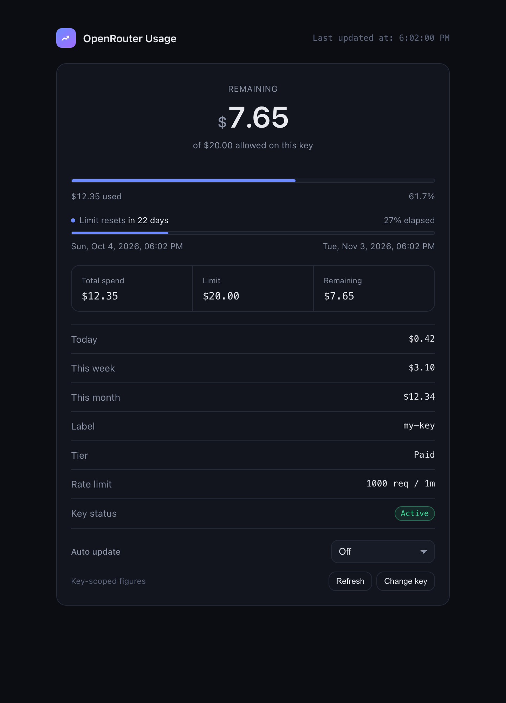

# OpenRouter Usage Info

A single-file web page that shows your OpenRouter usage and remaining balance using **only an API key** — no account login required.

If you were handed an OpenRouter API key by someone else (a team lead, a client, a shared account owner), you can spend against that key but you cannot sign in to the OpenRouter dashboard to see how much is left. This page fills that gap. Open it, paste your key, and read your spend.

**→ [Open the live page](https://amir14a.github.io/openrouter-usage-info/)**



---

## Why this exists

OpenRouter exposes a key-scoped endpoint, `GET /api/v1/auth/key`, that answers the one question an API key holder can otherwise never answer: *how much of my budget is left?*

That endpoint returns JSON, which is fine if you live in a terminal. This project wraps it in a small, readable UI you can open in any browser, so checking your balance takes two seconds instead of a `curl` command.

### The honest limitation

An API key can only see **its own** figures. It cannot see account-wide credits.

| Situation | What this page shows |
| --- | --- |
| Key has a spending limit | **Remaining balance** in dollars, plus a progress bar |
| Key has no spending limit | **Lifetime spend on the key** — remaining account balance is *not* reported by the API at all |
| Account has other keys | Only this key's usage. Other keys and total account credits require a login |

When the API cannot report a remaining balance, the page says so plainly in a banner rather than inventing a number. This is deliberate: a made-up balance is worse than an honest blank.

The only per-model breakdown endpoint, `GET /api/v1/activity`, requires a **provisioning key** and returns `401` for an ordinary inference key. So model-by-model spend is out of reach here too — see [Limitations](#limitations).

---

## Your API key is never stored anywhere

This is the most important thing to understand about the project, so it is worth being precise.

- **Nothing is sent to any server other than OpenRouter.** The page is a static HTML file. It has no backend, no analytics, no telemetry, and no third-party scripts, fonts, or CDNs. The key travels from your browser directly to `openrouter.ai`.
- **Nothing is written to disk.** The key is held in `sessionStorage`, scoped to a single browser tab. It is never written to `localStorage`, never placed in a cookie, and never put in the URL.
- **It disappears when the tab closes.** `sessionStorage` is cleared by the browser at the end of the session. Closing the tab discards the key; nothing persists for the next visit in a new tab.
- **It is never committed or bundled.** There is no `.env` file, no configuration file, and no build step. The repository contains no credentials of any kind.
- **You can verify all of this.** The entire application is one readable file, `index.html`. Search it for `fetch`, `localStorage`, or `sessionStorage` and confirm the claims above in about a minute.

Two honest caveats:

1. **"Refresh" re-reads the key from `sessionStorage`** — it does not keep a second copy in memory.
2. **A page you do not control could read that storage.** If you paste this file's contents into some other site, or load it inside a frame, that host's scripts could reach `sessionStorage`. Use the file from this repository, or the GitHub Pages URL, and you are fine.

> **Use a restricted key if you can.** Nothing here needs write access. Checking usage only requires the ability to read the key's own metadata, so a key with the narrowest possible scope is the right one to use.

---

## Features

**Usage and balance**
- Remaining balance, lifetime spend, and the configured limit, shown as large, legible figures
- A progress bar that shifts from blue to amber to red as the limit is consumed
- Daily, weekly, and monthly spend at a glance
- Key label, tier (paid or free), rate limit, and a status pill — *Active*, *Low balance*, *Exhausted*, or *Disabled*

**Limit reset tracking**
- Reads `resets_at` and `reset_interval` from the key's budget and derives the current window
- Shows the reset as readable text — *"in 22 days"*
- A second progress bar shows how far through the reset cycle you currently are, anchored by the exact start and end timestamps
- Comparing the two bars is the useful part: **61.7% spent at 27% elapsed** tells you the burn rate is roughly double the window, and when the limit will run out

**Auto update**
- Optional polling, selectable from **15 seconds to 5 minutes**, defaulting to **Off**
- A live countdown in the footer shows the time to the next refresh
- Polling **pauses automatically while the tab is hidden** and resumes when you return
- A failed background poll keeps your last good figures on screen instead of blanking them

**General**
- One self-contained file — no build step, no dependencies, no install
- Automatic light and dark themes following your system preference
- Specific, human error messages for invalid keys, permissions, and rate limits
- Amounts under a cent keep four decimals, so small spends do not round away to `$0.00`

---

## Usage

### Option 1: The hosted page

Open **<https://amir14a.github.io/openrouter-usage-info/>**, paste your key, and press **Check usage**.

### Option 2: Run it locally

```bash
git clone git@github.com:amir14a/openrouter-usage-info.git
cd openrouter-usage-info
open index.html          # macOS
# xdg-open index.html    # Linux
# start index.html       # Windows
```

Because it is a plain static file, double-clicking `index.html` works. OpenRouter sends `Access-Control-Allow-Origin: *` on the usage endpoint, so the request succeeds from a `file://` page.

If your browser is unusually strict about `file://` origins and blocks the request, serve the directory instead:

```bash
python3 -m http.server 8000
# then visit http://localhost:8000
```

### Option 3: Download a release

Every release attaches `index.html`, so you can grab a single file without cloning:

**<https://github.com/amir14a/openrouter-usage-info/releases/latest>**

---

## Releases

Releases are cut automatically by [`.github/workflows/release.yml`](.github/workflows/release.yml), which runs on every push to `main` and on manual dispatch.

The version comes from the **[`VERSION`](VERSION)** file at the repository root. Bump it to publish:

```bash
echo "1.0.1" > VERSION
git commit -am "Release 1.0.1"
git push
```

That creates a `v1.0.1` tag and a release with `index.html` attached. Commits that leave `VERSION` unchanged are a **no-op** — the workflow detects the existing release and exits successfully, so ordinary pushes to `main` never fail. Bumping `VERSION` is what cuts a release.

`VERSION` must be a plain semantic version (`1.2.3`); a leading `v` is tolerated, and anything else fails the job with a clear error.

---

## Limitations

Worth stating directly, so nobody is surprised:

- **Per-model usage is not available.** `GET /api/v1/activity` returns per-model aggregates but requires a provisioning key; an inference key gets `401`.
- **Account-wide balance is not visible.** If the key has no limit, the API reports spend but not remaining credits.
- **The figures are key-scoped.** Other keys on the same account do not appear.
- **Relative times are computed at render time.** With auto update off, "in 22 days" goes stale as the page sits open. Press Refresh or reload for current values.
- **API keys must be valid and active.** A revoked or malformed key returns a `401`, which the page reports clearly.

---

## Contributing

**Pull requests are welcome and genuinely encouraged.** This is a small project and it is fully open — bug reports, fixes, accessibility improvements, and new features are all fair game. You do not need permission to open a PR.

Ideas that would be welcome:

- A per-model breakdown table, for anyone holding a provisioning key
- Exporting history to CSV or JSON
- Keyboard shortcuts, and deeper screen-reader polish
- Additional `reset_interval` formats, if OpenRouter introduces any

A few conventions that keep the project maintainable:

- Keep it **one self-contained `index.html`** with no build step and no dependencies. That constraint is the point of the project.
- **Do not add third-party scripts, fonts, or CDNs.** The absence of external resources is a security feature — it is what makes the key-safety claims verifiable.
- Match the existing code style: ES5-compatible syntax, `var`, and short functions with a comment explaining *why* where the reasoning is not obvious.
- Keep light and dark themes both working.
- Test in a browser before opening the PR, and describe what you saw.

**Found a security issue?** Since this project handles API keys, please open an issue describing the concern without including a real key, and we will sort out disclosure from there.

---

## License

[MIT](LICENSE) — fully open.

You may use, copy, modify, merge, publish, distribute, sublicense, and sell this software, commercially or otherwise, with no conditions beyond preserving the copyright notice and license text. There is no warranty.

---

## Acknowledgements

Built against the [OpenRouter API](https://openrouter.ai/docs). Not affiliated with or endorsed by OpenRouter.
